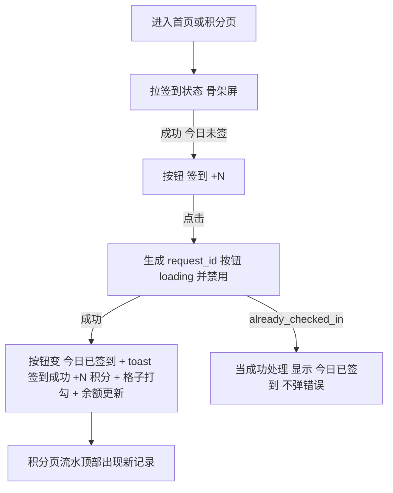
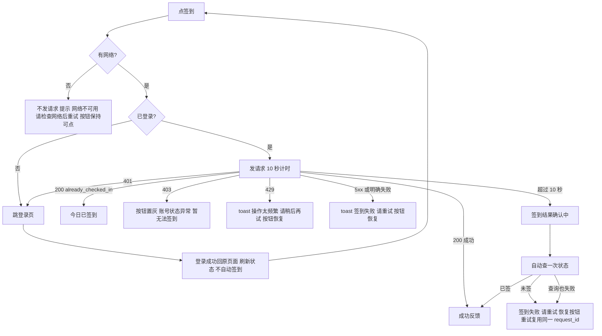

<!-- template: 04-interaction-spec | 负责：体验设计师 | 阶段：04 交互设计 -->
# 交互说明：App 每日签到 + 积分（checkin-points）

## 引用 <!-- 必填 -->
- 上游（已拍板）：/tmp/ra-e2e/app/workspace/checkin-points/02-PRD.md（US-01~US-11、R1~R10、「异常态与边界」、待拍板 1/2/3/4/6 的结论）
- 拍板结论：奖励数值 10 / 第 3 天 +10 / 第 7 天 +30，7 天循环；本期不做补签、不做推送；入口放首页卡片和积分页签到区两处。
- 项目背景：/tmp/ra-e2e/app/README.md（Android Kotlin + Jetpack Compose）
- 配套产物：/tmp/ra-e2e/app/workspace/checkin-points/04-视觉标注.md
- 没有 Figma / MasterGo 设计稿，本文用文字和 ASCII 线框表达。文案全部按 PRD；PRD 没写、设计补充的文案和状态，一律标「【设计补充】」，需产品确认。

## 信息架构 <!-- 必填 -->
```
DemoApp
├─ 首页
│   └─ 签到卡片（入口 A）            -> 点卡片空白处进积分页；点按钮直接签到
├─ 积分页（入口 B，来源：首页卡片 / 我的 / 其他，来源由 source 参数区分）
│   ├─ 余额区（积分余额，整数千分位）
│   ├─ 签到区（7 天格子 + 连签文案 + 签到按钮）
│   └─ 流水列表（倒序，20 条/页，滑到底自动翻页）
└─ 登录页（未登录点签到时跳转，登录后回到原页面）
```
- 两处入口共用同一份签到状态（同一个 ViewModel / Repository 数据源），任一处签到成功，另一处下次出现时必须同步。
- 签到成功反馈、错误提示统一用同一套文案和组件，不允许两处各写一套。
- 首页卡片是「轻入口」：只显示今日状态 + 按钮；7 天格子和流水只在积分页。

## 任务流程 <!-- 必填 -->
**主流程（已登录、今天未签）**


**分支流程**


**其他流程**
- 断签：打开签到区时，服务端返回今日按「周期第 1 天」计算，签到前显示「连签已中断，今天重新开始」，签到后按第 1 天展示。
- 跨零点：页面停在「今日已签到」，过北京时间 00:00 后 App 回前台或页面 onResume，重新拉状态，按钮变回「签到 +N」；不做实时倒计时刷新。
- 23:59:59 点击、00:00 后才到服务端：按服务端返回的 `checkin_date` / `cycle_day` 展示（已知、可接受），格子和文案以返回值为准，不用本地时间推算。
- 空态引导：流水为空，点「去签到赚积分」，页面滚动到签到区并把焦点给签到按钮。

## 页面与状态 <!-- 必填 -->

### 1. 首页签到卡片（入口 A）
线框（宽 360dp 屏）
```
┌──────────────────────────────────────────┐
│ [礼物图标]  每日签到                     │
│            已连续签到 3 天     [ 签到 +20 ]│
└──────────────────────────────────────────┘
```
已签到：
```
┌──────────────────────────────────────────┐
│ [对勾图标]  每日签到                     │
│            已连续签到 3 天   [ 今日已签到 ]│  (按钮禁用样式，不是错误)
└──────────────────────────────────────────┘
```

| 页面 / 组件 | 状态 | 触发条件 | 展示与文案 | 交互 |
|---|---|---|---|---|
| 首页签到卡片 | 加载中 | 首次进首页、拉状态中 | 卡片骨架屏（标题行、副标题行、按钮占位）；不显示旧值 | 卡片不可点；加载超过 10 秒转「加载失败」 |
| 首页签到卡片 | 未签（默认） | 已登录，今日未签 | 标题「每日签到」；副标题「已连续签到 X 天」；按钮「签到 +N」，N = `today_points_preview`（含奖励，周期第 3 天为 20、第 7 天为 40，其余 10） | 点按钮签到；点卡片其余区域进积分页 |
| 首页签到卡片 | 新用户未签过 | `streak_days` = 0 | 副标题「每天签到领积分」（【设计补充】，避免显示「已连续签到 0 天」）；按钮「签到 +10」 | 同上 |
| 首页签到卡片 | 断签 | 最近签到早于昨天 | 副标题「连签已中断，今天重新开始」；按钮「签到 +10」 | 同上 |
| 首页签到卡片 | 签到中 | 点击后请求中 | 按钮内 loading 圈，文案隐藏，按钮禁用；卡片其余区域仍可点进积分页 | 请求中再点无响应（防重复，且不算一次新点击） |
| 首页签到卡片 | 已签 | 今日已签，或收到 `already_checked_in` | 副标题「已连续签到 X 天」；按钮「今日已签到」禁用 | 点卡片进积分页 |
| 首页签到卡片 | 超时确认中 | 请求 > 10 秒无响应 | 按钮禁用，显示 loading + 「签到结果确认中」；副标题不变 | 自动查状态，期间不可点 |
| 首页签到卡片 | 未登录 | 无登录态 | 副标题「每天签到领积分」（【设计补充】）；按钮「签到」（未登录拿不到预览分值，不显示 +N，【设计补充】） | 点按钮或卡片：跳登录页；登录成功回首页，刷新状态，不自动签到 |
| 首页签到卡片 | 无权限 403 | 账号封禁或注销中 | 按钮置灰禁用；卡片副标题位置改为「账号状态异常，暂无法签到」 | 点卡片仍可进积分页看余额和流水 |
| 首页签到卡片 | 加载失败 | 状态接口 5xx、解析失败（PRD 整页失败文案）【设计补充：卡片内行内表达】 | 卡片内显示「加载失败，点击重试」，按钮隐藏 | 点卡片任意处重新拉状态；不弹 toast，不影响首页其他模块 |
| 首页签到卡片 | 无网 | 无网络且无缓存状态 | 卡片显示「网络不可用，请检查网络后重试」；有缓存状态时照常显示缓存的卡片 | 点按钮：不发请求，toast「网络不可用，请检查网络后重试」 |

### 2. 积分页（余额 + 签到区 + 流水）
线框
```
┌──────────────────────────────────────────┐
│ ←  我的积分                              │
├──────────────────────────────────────────┤
│  积分余额                                │
│  1,280                                   │
│  （无网缓存时）数据可能不是最新          │
├──────────────────────────────────────────┤
│  每日签到                  每日 0 点（北京时间）刷新 │
│  已连续签到 3 天                         │
│ ┌──┬──┬──┬──┬──┬──┬──┐                   │
│ │✓ │✓ │✓ │▣ │  │  │  │  ✓已签 ▣今天     │
│ │第1│第2│第3│第4│第5│第6│第7│              │
│ │+10│+10│+20│+10│+10│+10│+40│             │
│ └──┴──┴──┴──┴──┴──┴──┘                   │
│  [          签到 +10          ]          │
├──────────────────────────────────────────┤
│  积分明细                                │
│  每日签到             +10                │
│  2026-11-14 09:12                        │
│  连续签到奖励         +10                │
│  2026-11-13 09:05                        │
│  ...                                     │
│  没有更多了                              │
└──────────────────────────────────────────┘
```
（第 3 天、第 7 天的格子用强调底色并带小角标「额外 +10」「额外 +30」，格子数值显示当天合计 10/10/20/10/10/10/40，见视觉标注。）

| 页面 / 组件 | 状态 | 触发条件 | 展示与文案 | 交互 |
|---|---|---|---|---|
| 积分页整体 | 首次加载 | 进页面，状态和流水都在拉 | 余额、签到区、流水前 5 行均为骨架屏；顶栏标题正常显示 | 不可操作按钮；下拉刷新可用 |
| 积分页整体 | 整页加载失败 | 余额/状态/流水首屏接口 5xx 或解析失败，且无缓存 | 整页居中：「加载失败，点击重试」 | 点击重新拉三个接口 |
| 积分页整体 | 部分失败【设计补充】 | 状态成功、流水失败（或相反） | 失败的区块内显示「加载失败，点击重试」，成功的区块正常显示 | 只重试失败区块 |
| 积分页整体 | 无网（有缓存） | 无网络，有上次缓存 | 显示缓存余额和流水，余额区下方标注「数据可能不是最新」（P1）；签到按钮可点但点后提示无网 | 下拉刷新时提示「网络不可用，请检查网络后重试」 |
| 积分页整体 | 无网（无缓存） | 无网络，无缓存 | 整页居中：「网络不可用，请检查网络后重试」+「点击重试」（【设计补充】，文案沿用 PRD 无网文案） | 点击重试：有网则重拉，仍无网则同一提示 |
| 积分页整体 | 未登录 | 无登录态或 401 | 不展示余额和流水，直接跳登录页；登录成功回积分页并刷新 | 登录取消则回到来源页（【设计补充】） |
| 余额区 | 正常 | 返回余额 | 整数，千分位（1,280），余额 ≥ 10,000 不截断；字号随系统放大时换行或缩小到下限，不出现省略号 | 无 |
| 余额区 | 新用户 | 余额 0 | 显示 0 | 无 |
| 余额区 | 签到成功后 | 签到成功 | 数值从旧值滚动到新值，约 600ms（尊重系统「移除动画」，关闭时直接变） | 无 |
| 签到区 7 天格子 | 默认（未签） | 今日未签 | 已签的格子打勾，今天高亮（边框 + 底色），未到的格子普通；第 3、7 天带额外奖励标注；下方「已连续签到 X 天」 | 格子不可点（本期无补签），无按压态，TalkBack 里只读 |
| 签到区 7 天格子 | 今日已签 | 今日已签 | 今天的格子也打勾；高亮变为「已完成」样式；明天格子带「明天 +N」提示（P1，【设计补充】） | 同上 |
| 签到区 7 天格子 | 周期第 7 天已签 | `cycle_day` = 7 且已签 | 7 个格子全部打勾；连签天数继续累加（如「已连续签到 7 天」，第 8 天签到后显示「已连续签到 8 天」，格子重置为只有第 1 天打勾） | 无 |
| 签到区 7 天格子 | 断签 | 最近签到早于昨天 | 格子全部未打勾，第 1 天高亮为今天；文案「连签已中断，今天重新开始」替换「已连续签到 X 天」；签到后文案变回「已连续签到 1 天」 | 无 |
| 签到区 7 天格子 | 新用户 | 从没签过 | 格子全未勾，第 1 天高亮；文案「每天签到领积分」（【设计补充】） | 无 |
| 签到区 7 天格子 | 规则变更当天 | R5 配置生效日 | 当天已签的格子数值不变；次日按新规则显示预览 | 无 |
| 签到按钮 | 未签 | 默认 | 「签到 +N」 | 点击：见任务流程 |
| 签到按钮 | 请求中 | 点击后 | loading 圈，禁用；文案隐藏 | 无响应 |
| 签到按钮 | 超时确认中 | > 10 秒 | loading +「签到结果确认中」，禁用 | 自动查询状态 |
| 签到按钮 | 已签 | 今日已签 / `already_checked_in` | 「今日已签到」，禁用样式（不是红色错误态） | 无 |
| 签到按钮 | 403 | 账号封禁/注销中 | 禁用，按钮下方（或替换按钮文字区）显示「账号状态异常，暂无法签到」，文字用 `onSurfaceVariant`，不用 disabled 灰，保证可读 | 无 |
| 签到按钮 | 未登录 | 无登录态 | 「签到」；点击跳登录 | 见任务流程 |
| 签到按钮 | 限流 429 | 1 分钟超过 10 次 | toast「操作太频繁，请稍后再试」；按钮立即恢复可点 | 无 |
| 签到按钮 | 失败 | 5xx 或明确失败 | toast「签到失败，请重试」；按钮恢复 | 可再点，生成新 `request_id`（超时重试才复用） |
| 签到区 | 跨零点 | 回前台或 onResume 时已过北京时间 00:00 | 重新拉状态：按钮由「今日已签到」变回「签到 +N」；格子按新日期刷新 | 刷新期间签到区局部骨架屏，不整页闪 |
| 签到区 | 并发（另一台设备已签） | 本机点击时服务端返回 `already_checked_in` | 显示「今日已签到」，格子和余额按服务端返回刷新，不报错 | 无 |
| 流水列表 | 有数据 | 返回流水 | 每条：类型名称（左，`CHECKIN_BASE`=「每日签到」，`CHECKIN_STREAK_BONUS`=「连续签到奖励」）、变动值（右，「+10」，成功绿色）、发生时间（北京时间 yyyy-MM-dd HH:mm，副文字） | 不可点（本期无详情页） |
| 流水列表 | 空态 | 新用户无流水 | 插画 +「还没有积分记录」+ 按钮「去签到赚积分」 | 点按钮：滚动到签到区，焦点落到签到按钮 |
| 流水列表 | 加载下一页 | 滑到倒数第 5 条触发 | 底部 loading 圈 | 无 |
| 流水列表 | 下一页失败 | 翻页接口失败 | 底部「加载失败，点击重试」，已加载数据保留 | 点底部重试该页，不回到顶部 |
| 流水列表 | 到底 | `has_more=false` | 底部「没有更多了」 | 无 |
| 流水列表 | 未知类型 | 后端返回预留类型 `REDEEM`/`ADJUST`/`EXPIRE`（本期不会产生）【设计补充】 | 类型名称用服务端 `remark`，为空则显示「积分变动」；负数变动值用 `onSurface` 色并带「-」，不用绿色 | 无 |
| 流水列表 | 新签到插入 | 本页签到成功 | 列表顶部插入新记录（基础一条，有奖励再加一条），出现时淡入，不触发整页刷新；游标分页保证翻页不重复 | 无 |

### 3. 签到成功反馈
| 页面 / 组件 | 状态 | 触发条件 | 展示与文案 | 交互 |
|---|---|---|---|---|
| Toast | 成功 | 签到事务成功 | 「签到成功 +N 积分」，N = 基础分 + 奖励分（周期第 3 天 +20，第 7 天 +40，其余 +10）；展示 2 秒 | 自动消失；TalkBack 播报 |
| 按钮 | 成功 | 同上 | 「签到 +N」→ 「今日已签到」，带 200ms 淡入淡出切换 | 禁用 |
| 今日格子 | 成功 | 同上 | 打勾，勾出现时缩放 0.6 → 1.0，约 300ms（P1 动效）；周期第 3、7 天额外奖励格子加一次轻微脉冲（约 400ms） | 无 |
| 余额 | 成功 | 同上 | 数值滚动更新（约 600ms） | 无 |
| 触感 | 成功 | 同上 | 一次轻触感（`HapticFeedbackType.ConfirmTap` 或等价，待研发确认 API 级别） | 系统关闭触感则不触发 |
| 首页卡片 | 成功 | 在首页卡片点的签到 | 同按钮变化；副标题「已连续签到 X 天」随之 +1；不跳页面 | 无 |
| 重复提交 | `already_checked_in` | 重复点击 / 另一台设备已签 | 不弹 toast，不显示错误，直接显示「今日已签到」（PRD US-02） | 无 |

## 异常态与文案 <!-- 必填 -->
全部文案按 PRD「异常态与边界」，一字不改；【设计补充】项除外。

| 场景 | 文案 | 形式 | 恢复方式 |
|---|---|---|---|
| 空态：没有流水 | 「还没有积分记录」按钮「去签到赚积分」 | 流水区内插画 + 文案 + 按钮 | 点按钮到签到区 |
| 空态：今天未签 | 按钮「签到 +N」 | 按钮文案 | 点击签到 |
| 加载中 | 无文案 | 骨架屏；按钮 loading；翻页底部 loading 圈 | 自动 |
| 加载失败（整页） | 「加载失败，点击重试」 | 整页居中 | 点击重试 |
| 加载失败（下一页） | 「加载失败，点击重试」 | 列表底部，保留已加载数据 | 点击重试 |
| 签到失败 | 「签到失败，请重试」 | toast，按钮恢复可点 | 再点一次（新 request_id） |
| 无网 | 「网络不可用，请检查网络后重试」；缓存标注「数据可能不是最新」 | 不发请求，toast；积分页有缓存则显示缓存 | 网络恢复后手动点按钮/下拉刷新；网络恢复事件不自动签到 |
| 未登录 / 登录过期 | 无文案，跳登录页 | 跳转 | 登录成功回原页面刷新，不自动签到 |
| 无权限 403 | 「账号状态异常，暂无法签到」 | 按钮置灰 + 说明文字；余额和流水能看 | 无（需联系客服，本期不放入口） |
| 超时 | 「签到结果确认中」，未签时转「签到失败，请重试」 | 按钮 loading + 文案；查询后转成功或失败 | 自动查一次状态；失败后重试复用同一 `request_id` |
| 重复提交 | 「今日已签到」 | 请求中按钮禁用；收到 `already_checked_in` 当成功 | 无 |
| 并发（两台设备） | 一台「签到成功 +N 积分」，另一台「今日已签到」 | 同上 | 两边余额以服务端为准 |
| 限流 429 | 「操作太频繁，请稍后再试」 | toast | 按钮恢复，稍后再点 |
| 跨天：停在页面过零点 | 无文案 | 回前台或 onResume 重新拉状态 | 自动 |
| 跨天：23:59:59 点击 | 按服务端返回的日期展示 | 成功 toast + 格子按服务端 `cycle_day` | 无 |
| 时区非 UTC+8 / 改系统时间 | 「每日 0 点（北京时间）刷新」；流水时间按北京时间 | 签到区右上角副文字常驻；不依赖本地时间 | 无 |
| 断签 | 「连签已中断，今天重新开始」 | 替换「已连续签到 X 天」 | 签到后显示第 1 天 |
| 规则变更当天 | 无文案 | 当天已签不变，次日预览新数值 | 无 |
| 余额数值大 | 无文案 | 千分位，不截断 | 无 |
| 数据不一致 | 无（用户侧无感） | 无 | 服务端告警处理 |

补充规则
- 超时确认中的状态机：IDLE → SUBMITTING（0~10s）→ CONFIRMING（> 10s，自动查状态一次）→ SUCCESS / FAILED。CONFIRMING 期间按钮禁用；CONFIRMING 内查状态也失败，按「签到失败，请重试」处理，重试复用同一 `request_id`，服务端幂等保证不重复发分。
- 失败提示统一用 toast（签到失败、429、无网）；会让用户停留的状态（加载失败、403、未登录）用页面内文案。
- toast 同一时刻只保留一条，后来的替换前一条，避免连点后堆叠。
- 错误不使用技术码，`error_code` 只走埋点和日志。

## 多端差异 <!-- 必填 -->
- 本期只有 Android（Kotlin + Jetpack Compose，Material 3）。iOS、鸿蒙、Web、小程序本期都不做，本文不含这些端的差异说明。
- Android 内部差异：
  - 返回：系统返回键和顶栏返回键行为一致，请求中返回不取消请求，结果回来后若页面已销毁则只刷新缓存状态，不弹 toast。
  - 系统字体放大、深色模式、动态取色（若项目启用）都要适配，见视觉标注。
  - Android 13+ 通知权限与本期无关（本期不做推送）。
  - 手势导航下底部安全区（navigation bar inset）要留出，积分页列表末尾不被手势条遮挡。
- 以后扩到其他端时，7 天格子的交互、状态机、文案保持一致，仅视觉用各端原生组件。

## 可访问性 <!-- 必填 -->
- 对比度：文字 ≥ 4.5:1，大字（≥ 18sp 或粗体 ≥ 14sp）和图标 ≥ 3:1。「+10」绿色必须通过对比度检查（见视觉标注 `success`），除颜色外保留「+」号。
- 点击区：签到按钮、卡片、重试、「去签到赚积分」高度 ≥ 48dp，宽度 ≥ 48dp。7 天格子不可点，不要求 48dp，但文字不低于 11sp。
- 不只靠颜色：已签 = 对勾图标 + 文案，今天 = 边框 + 底色 + 「今天」语义，额外奖励 = 角标文字，不只靠色块。
- 字体放大：支持到系统 200%。字号放大到 1.3 倍以上时，7 天格子由单行 7 格改成两行（4 + 3）；余额、按钮文字允许换行，不截断，不出现省略号；卡片高度自适应。
- TalkBack：
  - 每个格子合并成一个节点，朗读如「第 3 天，已签到，当天获得 20 积分」「第 4 天，今天，未签到，可获得 10 积分」「第 7 天，未签到，可获得 40 积分，含额外奖励 30」。
  - 签到按钮朗读「签到，可获得 N 积分，按钮」；已签朗读「今日已签到，按钮，不可用」；403 把「账号状态异常，暂无法签到」作为按钮的状态说明一并朗读。
  - 成功 toast、失败 toast、「签到结果确认中」用 live region（polite）播报；loading 中朗读「加载中」。
  - 流水每条合并为一个节点：「每日签到，增加 10 积分，2026-11-14 09:12」。
  - 跳登录再返回后，焦点回到签到按钮。
- 动效：尊重系统「移除动画」（`Settings.Global.ANIMATOR_DURATION_SCALE` = 0，或 Compose 的 reduce motion 判断），关闭时勾选、余额滚动、脉冲直接显示结果，不播放。
- 触感：成功触感随系统触感反馈开关。
- 焦点顺序：返回 → 余额 → 签到区文案 → 签到按钮 → 流水列表。
